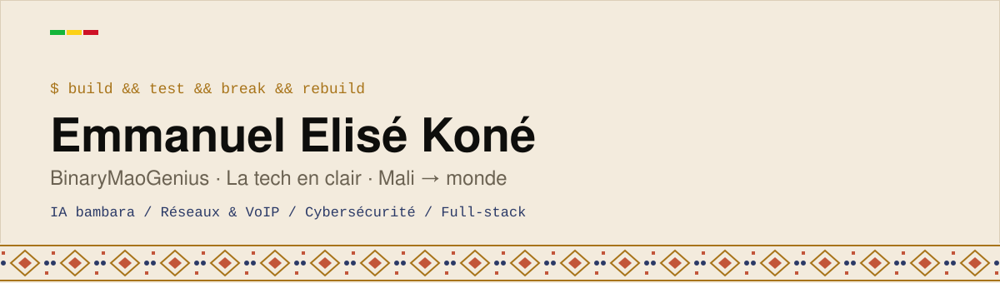

  <picture>
    <source media="(prefers-color-scheme: dark)" srcset="assets/banner-dark.svg">
    
  </picture>

**🇫🇷** Étudiant en Réseaux, Systèmes et Sécurité à l'IUE (Mali). J'apprends en construisant : tester, casser *(en labo, avec autorisation)*, reconstruire, et documenter, y compris ce qui ne marche pas du premier coup.

**🇬🇧** Systems, Networks & Security student at IUE (Mali). I learn by building, testing, breaking things in authorised labs, rebuilding, and writing down what I learn.

## 🧪 Le labo — four rooms

<table>
<tr>
<td width="50%" valign="top">

### 🎙️ Voix bambara
**[Queue Buddy](https://github.com/BinaryMaoGenius/queue-buddy)** · `MVP en cours`
Gestion de files d'attente par la voix en bambara : tickets numériques et notifications. *Flutter · Dart · Python*

</td>
<td width="50%" valign="top">

### 🧠 IA locale
**[COS — Cognitive Operating System](https://github.com/BinaryMaoGenius/argus-core)** · `MVP en cours`
Un noyau cognitif local-first pour machines sans GPU : mémoire, planification, vérification. *Python · Ollama*

</td>
</tr>
<tr>
<td width="50%" valign="top">

### 🛡️ Cybersécurité
**[Digital Day CTF](https://github.com/BinaryMaoGenius/digital-day-ctf)** · `Déployé`
Plateforme CTF construite pour Digital Day (Club IT Mali) : des centaines de participants, des défis réels. *Python · CTFd*

</td>
<td width="50%" valign="top">

### 📡 Réseaux & VoIP
**[VoIP MX-ONE Lab](https://github.com/BinaryMaoGenius/voip-mxone-lab)** · `Terminé`
Déploiement d'un IPBX Mitel MX-ONE sous SUSE virtualisé : extensions SIP, trunk, dépannage documenté. *VMware · SIP · Wireshark*

</td>
</tr>
</table>

**Aussi :** [Bamatech](https://github.com/BinaryMaoGenius/Bamatech) (plateforme pour l'écosystème tech malien) · [Griot Numérique](https://github.com/BinaryMaoGenius/Griot_numerique) (préserver la culture orale) · [Virtual Mouse](https://github.com/BinaryMaoGenius/virtual-mouse-gestures) (souris pilotée par les gestes de la main)

## 🧰 Stack

## 🔧 Comment je construis

1. **Comprendre** le problème avant de choisir la techno.
2. **Tester** et expliquer : une solution que je ne sais pas expliquer n'est pas finie.
3. **Local-first** et open source quand c'est pertinent.
4. **Documenter** aussi les échecs. *La tech en clair.*

## 📬 Connect

[LinkedIn](https://www.linkedin.com/in/emmanuelekone) · [Hugging Face](https://huggingface.co/binaryMao)

> *Build. Test. Break (in the lab). Rebuild.* · *Mali to the world* 🇲🇱
