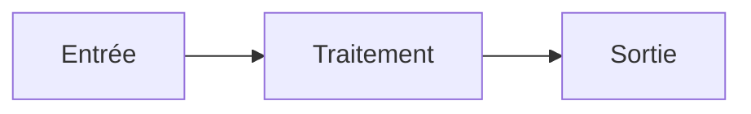

<div align="center">
  <picture>
    <source media="(prefers-color-scheme: dark)" srcset="assets/banner-dark.svg">
    
  </picture>
</div>

> Une phrase : ce que ça fait, pour qui.

## Le problème
2–3 lignes. Pourquoi ça existe.

## L'approche
Les choix faits et **pourquoi** (contraintes : matériel, langue, réseau, budget).

## Démo


## Architecture


## Ce qui a cassé / ce que j'ai appris
Les échecs honnêtes : c'est ce qui distingue un vrai projet.

## Lancer le projet
```bash
# installation en 3 commandes max
```

## Statut
`LAB` · `MVP EN COURS` · `TERMINÉ` · `DÉPLOYÉ`  — et la prochaine étape.

## Licence
À préciser.
